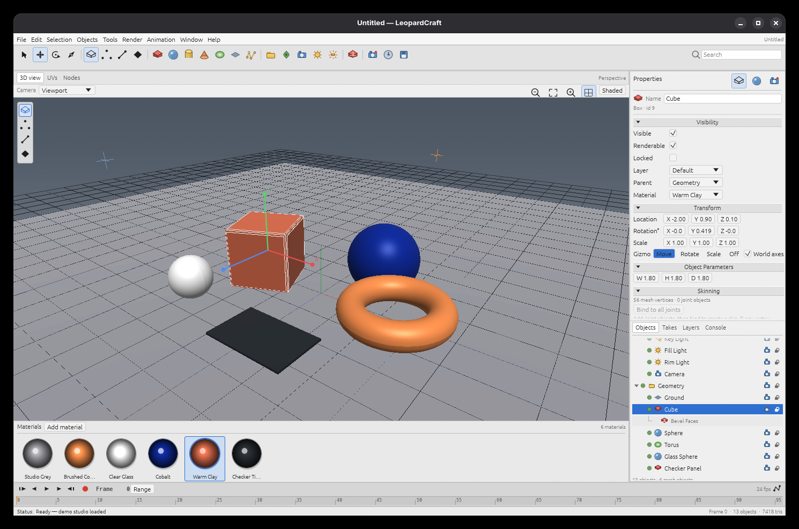

# LeopardCraft

LeopardCraft is a clean-room, offline-first 3D modelling, rendering and animation
application written in pure Rust. It is inspired by the focused, approachable
workflow of classic polygon modellers and by the native, crash-resistant
engineering ethos of the ArtCraft suite, but its architecture and implementation
are original.

- **Native:** Linux, macOS and Windows (eframe + wgpu).
- **Offline:** no telemetry, accounts, network services or cloud dependencies.
- **Deterministic:** headless scene evaluation, stable IDs and an undo/redo
  command history.
- **Tested:** geometry, shading, animation, scene evaluation, rendering and file
  I/O all have automated round-trip and regression tests.

## Screenshots



The editor on first launch, captured from the running application: the shaded viewport with the studio
cube, sphere, torus and glass sphere, the transform gizmo, the `Properties` column, the `Objects` browser,
the material shelf and the full-width timeline. The status bar reads `Frame 0 · 13 objects · 7418 tris`.

## Quick start

Prebuilt Linux (AppImage, .deb, .rpm, tarball), macOS (Apple silicon and Intel) and Windows builds for 0.1.1 are on the [releases page](https://github.com/Aclevo/LeopardCraft/releases/tag/v0.1.1); the steps below build from source.

```bash
cargo run -p leopardcraft
```

The editor opens with a ready-to-use studio scene: camera, three-point lighting,
ground, beveled cube, animated sphere and torus, glass sphere, checker panel and
six materials.

```bash
cargo test --workspace
cargo run -p leopardcraft -- --headless selftest
```

`selftest` checks deterministic evaluation, native serialization, PNG/EXR
output and OBJ/STL/GLB round-trips in a temporary directory.

## Workspace layout

| Crate | Responsibility |
| --- | --- |
| `lc-core` | math helpers, transforms, bounds, rays, PCG32, colour, tonemapping, stable hashing |
| `lc-geom` | n-gon mesh, primitives, splines, UV projection/relaxation, BVH, extrude/bevel/ring-cut/bridge, subdivision, BSP booleans |
| `lc-shading` | node material graph, Principled surface, procedural noise, texture cache |
| `lc-anim` | F-curves, animation tracks, playback, indexed skinning |
| `lc-scene` | scene graph, tags, layers, document format, deterministic evaluation, undo commands |
| `lc-render` | camera models, flattened render scene, BVH, CPU path tracer, PNG and EXR writers |
| `lc-io` | native `.lcscene`, OBJ/MTL, STL, glTF/GLB import and export |
| `lc-ui` | Cheetah-style fixed egui workspace, wgpu viewport, inspectors, material graph, UV view, timeline |
| `app` | `leopardcraft` native binary and headless CLI |

The native scene format is pretty-printed JSON with a format/version header. It is
validated and sanitized on load. Document signatures ignore allocator counters, so
save/load round-trips can be compared deterministically.

## Editor

The fixed workspace is laid out like a classic Mac modeller: a menu bar and
original vector-icon toolbar, a `3D view | UVs | Nodes` switcher above the
viewport, a Properties column over an `Objects | Takes | Layers | Console`
browser, a material-sphere shelf, a full-width timeline and a separate Render
Manager window.

- **3D Viewport** — wgpu shaded/wireframe display with a blue-grey gradient,
  light floor grid, white selected wireframe, light and camera helpers,
  orbit/pan/zoom navigation and a transform gizmo. Alt+drag orbits or pans.
- **Multi-object selection** — Shift/Cmd-click adds or removes objects in the
  viewport or Object Browser; drag in the viewport to box-select (Shift/Cmd
  adds). The last clicked object stays the inspector's primary. The gizmo
  moves, rotates or scales the whole selection around a shared pivot, and
  Delete, Duplicate, visibility, render and lock changes apply to the whole
  selection as one undo step. Group Selection and Selected Flags are in the
  Objects menu; the Object Browser context menu can also reparent or unparent
  the selection.
  Convert to Editable Mesh, Add Subdivision, Add Boolean Subtract, every UV
  projection operation and Key Transforms also apply to the whole selection as
  one undo step. Context-menu Frame Selected keeps the existing selection and
  frames all of it rather than collapsing to the right-clicked row; mesh-only
  menu and toolbar actions are disabled when the selection contains no mesh,
  and UV projection requires every selected mesh to be editable. Selected Flags
  are enabled per flag only while some selected object still needs that change,
  and Key Transforms only while some selected transform is not already keyed at
  the current frame.
  Component modes accept any selection made only of meshes; entering a mode
  converts every selected primitive in one undo step, so primitives and
  editable meshes can be edited together. Select All Components and Deselect
  All Components act on every selected mesh, and the topology tools either
  apply to every selected mesh with one undo step or are disabled/refused when
  any selected mesh lacks the required component selection. Mixed selections
  containing lights, cameras or other non-mesh objects are refused.
- **Object Browser** — hierarchical scene tree with type icons, visibility,
  render and lock toggles, modifier rows, and a layer manager.
- **Properties / Tags** — icon tabs for object, material and render settings;
  object, camera, light, spline and primitive parameters; modifier stack; tags;
  skin binding; mesh-editing tools; spline control points. Modifier, skin and
  direct UV-point controls edit the primary object only.
- **Node Materials** — material shelf with shaded sphere previews and an
  editable light-canvas shader graph with Principled, noise, voronoi, ramp,
  math, texture, normal and emission nodes. Material roughness and metallic
  honour material-scope animation keys during evaluation.
- **UV Editor** — planar/box/cylindrical/spherical projection, auto-unwrap and
  relaxation apply to every selected editable mesh; direct UV-point dragging
  edits the primary editable mesh and needs an existing UV set.
- **Timeline / F-Curves** — transport, frame ruler, key diamonds, orange
  playhead, scrubbing, key insertion and an expandable curve editor. Click a
  key to select it, drag it to a new frame, right-click it or use Delete Key to
  remove it, and cycle the interpolation of one selected key without changing
  the rest of the track. Rotation is a four-component quaternion channel:
  Linear keys use shortest-path slerp, Stepped keys hold, and Smooth keys
  normalise a component-wise cubic, so sign-opposed quaternions cannot flip or
  pop. One channel registry declares every animatable property, its scope
  (object, tag or material), applicability and component count; recording and
  the curve editor both resolve channels through it. The curve editor's target
  selector switches between the primary object, each Copy Location tag and the
  selected material. Rows are generated from the registry for that scope,
  including channels that have no keys yet; select a row and use `Key Channel`
  to record it. Tag keys are stored in a per-tag clip and material keys in the
  material clip. Shift/command-click or drag a marquee over the curve view to
  select multiple scalar or quaternion keys; dragging one selected key moves the
  whole selection while preserving spacing. Copy/paste with the header buttons
  or Ctrl/Cmd+C and Ctrl/Cmd+V works across objects, tags and materials: keys
  keep their offsets from the earliest copied key, paste starts at the playhead,
  and colliding keys are overwritten. Selection, multi-key drag, paste and
  overwrite each collapse to one undo step through the same animation commands
  as single-key editing.
- **Render Manager** — capped job history with thumbnails and info, live
  progress, cancellation, and PNG/EXR export from background CPU path tracing.

### Document safety

- The title bar marks unsaved changes with `*`.
- New, Open and Quit ask before discarding unsaved work; the window close button
  follows the same path.
- Saves and exports are atomic: a flushed temporary file in the target
  directory replaces the target, so an interrupted write cannot truncate an
  existing scene or export.
- Native `.lcscene` saves use that atomic replace without a backup file. After
  the rename, the parent directory is flushed so the new entry is durable;
  platforms without directory syncing degrade to a no-op. A crash can leave
  only a hidden temporary sibling; the next save, opening the scene from any
  directory, or app launch in the scene's directory removes it. Recovery and
  directory-flush failures are warnings shown in the status bar and Console,
  and do not block startup, opening or saving.
- OBJ/MTL pairs commit transactionally. If a crash leaves transaction siblings
  behind, the next export to that pair — or app launch in the export directory
  or the opened scene's directory — restores the previous pair or keeps the
  fully installed pair, then removes the temporary and backup files.
- A failed write — empty target, missing directory, or I/O error — keeps the
  document dirty, returns any pending close/open confirmation, reports the
  error, and leaves no partial target or temporary file behind.
- While a scene has unsaved changes the editor writes a recovery snapshot every
  15 seconds to `$XDG_STATE_HOME/leopardcraft` (default
  `~/.local/state/leopardcraft`); `LEOPARDCRAFT_RECOVERY_DIR` overrides the
  location. The next launch offers to recover the snapshot. Saves, explicit
  discards and clean exits remove it.

### Mesh editing

Select one or more meshes, open **Properties / Tags → Mesh Editing** and press
**Enter Mesh Edit**. Primitives are converted to editable n-gon meshes first
(all selected primitives in one undo step). Click points, edges or polygons in
the viewport; Shift-click extends the selection. Component modes and Select
All/Deselect All Components cover every selected mesh, but require a mesh-only
selection. Topology tools validate the component selection on every selected
mesh before applying one combined undo step; they are disabled or refuse with a
status message rather than modifying only part of the selection. Ring Cut is
only offered when the cut plane strictly crosses geometry on every selected
mesh, Weld requires two distinct valid points on every mesh, and Bridge Loops is
only offered when every selected mesh has exactly two valid closed edge loops of
matching length. Each handler reuses its menu's predicate before touching
geometry, and Apply Transform is enabled only when the current mode, axis and
value would actually move components on every selected mesh.

The panel provides:

- Move, rotate and scale selected components on every selected mesh along world,
  local or average-normal axes.
- Region or individual extrude, inset, bevel, ring cut, weld selected points and
  bridge two selected edge loops.
- Assign the material selected in the Materials tab to selected polygons.
- Subdivision-surface smoothing through the non-destructive modifier stack.

### Splines, booleans and skinning

- Spline objects have linear, Bézier and smooth modes, editable control points,
  closed/open curves and a viewport preview with control-point markers.
- The Boolean modifier is created with **Add Boolean** in the modifier stack and
  chooses a mesh as Union, Subtract or Intersect operand. Add Modifier enables
  only entries whose geometry input exists: mesh modifiers on meshes, Sweep on
  splines, and Lathe everywhere; Boolean entries additionally require a valid
  mesh operand. Adding and removing a modifier each commit one edit.
- Mesh nodes can be bound to all Joint objects in the scene from the **Skinning**
  section. Binding creates inverse-bind matrices and starts every vertex fully
  weighted to the first joint; the evaluation path supports up to four weights.
  Binding and rebinding require a non-empty primary mesh and at least one joint;
  Rebind is disabled when it would reproduce the current skin unchanged.

### Viewport controls

| Input | Action |
| --- | --- |
| Left mouse | select an object or mesh component; Shift/Cmd-click toggles multi-selection; drag empty space to box-select; drag the gizmo to transform the selection |
| Middle mouse drag | orbit |
| Shift + middle drag | pan |
| Right mouse drag | pan |
| Mouse wheel | zoom |
| `F` | frame selected |
| `Cmd/Ctrl+Z` | undo |
| `Cmd/Ctrl+Shift+Z` | redo |
| `Delete` | delete selected objects |
| `Cmd/Ctrl+D` | duplicate selected objects |
| View menu | shading mode, grid, helpers |

## Headless CLI

```bash
# Path-traced PNG or EXR
leopardcraft --headless render \
  --scene scene.lcscene --out render.exr \
  --width 1280 --height 720 --samples 128 --seed 7

# Native scene or interchange export
leopardcraft --headless export --scene scene.lcscene --out model.glb

# Built-in deterministic smoke test
leopardcraft --headless selftest

# Non-interactive document lifecycle harness (dirty close/quit, Save As,
# write-failure recovery, timed autosave, snapshot recovery)
leopardcraft --headless lifecycle
```

Without `--scene` the CLI renders or exports the built-in studio. Render options
also include `--time` for animation frames. The path tracer uses deterministic
per-pixel seeds and progressive accumulation, so a given scene, time, seed and
sample count produce the same image.

## Rendering

The real-time viewport is a wgpu render pass into an offscreen texture that egui
composites with overlays. The offline renderer is a CPU path tracer with:

- perspective, orthographic and panoramic camera ray generation;
- environment/HDRI backgrounds and sun/point/area lights;
- next-event estimation, GGX specular, diffuse and dielectric transmission;
- reflections, refraction, shadows, depth of field and progressive accumulation;
- ACES tone mapping to PNG and linear half-float scanline EXR output.

## Interchange

| Format | Import | Export |
| --- | --- | --- |
| `.lcscene` | yes | yes |
| OBJ + MTL | yes | yes |
| STL (binary/ASCII) | yes | yes |
| glTF / GLB | yes | yes |

USDZ and Collada are not implemented. The native scene format is the only format
that preserves the complete document: hierarchy, tags, modifiers, animation,
skinning and shader graphs.

## Clean-room statement

This project does not contain, link to, inspect or reverse-engineer proprietary
code, binaries or file internals. The UI workflow is inspired by publicly
described polygon-modelling conventions. Geometry algorithms, the scene model,
shading graph, renderer and file parsers were designed from public graphics
mathematics and open format specifications, with original code.

## Status and limitations

LeopardCraft is an early 0.1 implementation. The engine and document model are
usable and covered by tests, but the editor is not yet a replacement for a mature
production modeller. Known limitations:

- Boolean and subdivision operations favour robustness over speed on large meshes.
- The viewport shading is a lightweight material preview, not the offline path
  tracer; the Render tab provides the final image.
- glTF export covers meshes, transforms and core PBR material values; advanced
  extensions, animations and skinning are not part of the interchange path yet.
- There is no external file-picker dependency; file paths are entered in the
  in-app dialog.
- GPU compute baking is not implemented; offline rendering is CPU-side.
- The 0.1 tree is native-first; a WASM/WebGPU application target is not wired up
  yet.
- Render export is single-frame. Animation playback is available in the editor,
  but there is no batch image-sequence render command yet.
- Skinning currently provides bind-to-joint setup and runtime evaluation; a
  weight-painting brush is not implemented.
- Older documents that animate rotation as three Euler curves still load and
  evaluate; new recordings write the quaternion rotation channel.
- The F-curve editor exposes registry channels for the primary object, a Copy
  Location tag or the selected material. Tag targeting is only offered for tags
  that declare an animation channel. Scale-in-time, key filtering and
  tangent-handle editing remain open.

## License

Licensed under either of:

- Apache License, Version 2.0 (`LICENSE-APACHE`)
- MIT License (`LICENSE-MIT`)

at your option.
